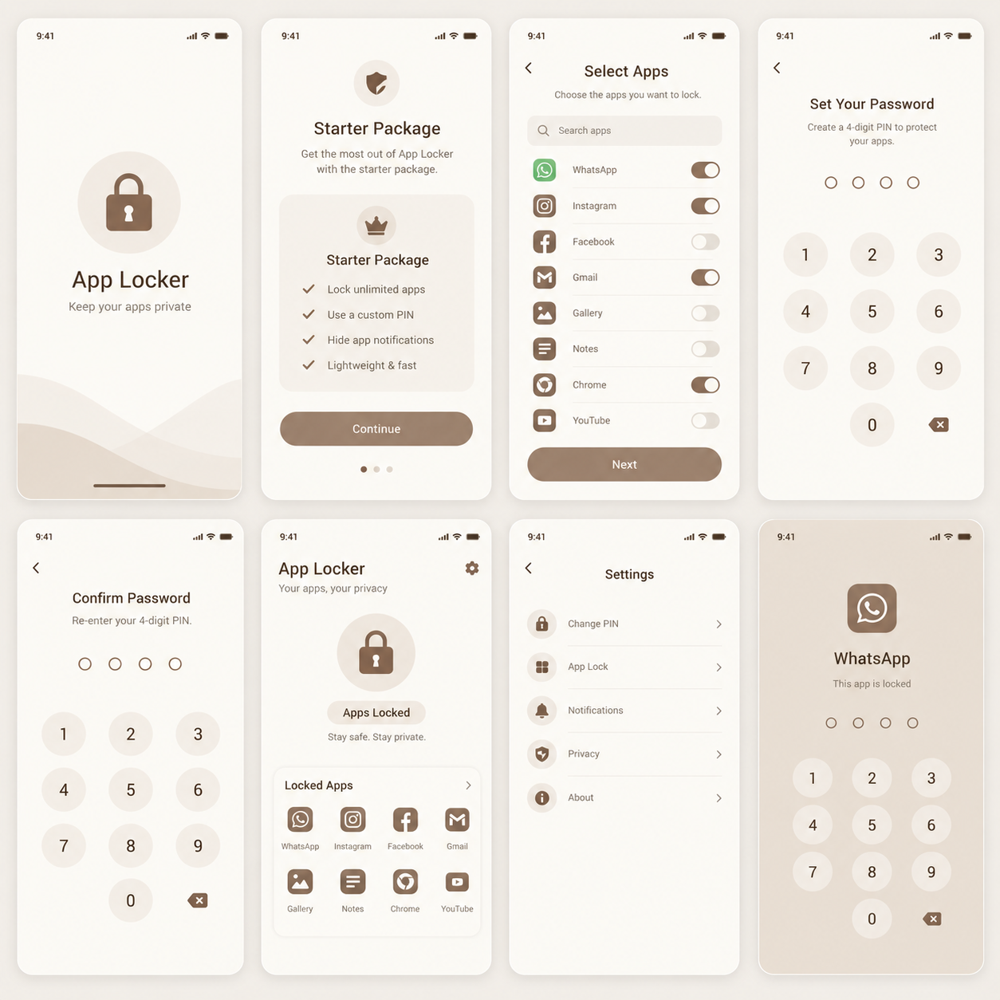

<p align="center">
  
</p>

# Hush App Locker 🤫

[](https://flutter.dev)
[](https://dart.dev)
[](https://developer.android.com)
[]()

**Hush** is a modern, privacy-first App Locker built with Flutter and native Android integration. Designed with precision, clean architecture, and a warm mocha design system, Hush keeps your personal apps, messages, and photos safe from unauthorized access.

---

## 📱 App UI Preview

<p align="center">
  
</p>

---

## ✨ Key Features

- 🔒 **App Locking**: Secure individual apps (WhatsApp, Instagram, Facebook, Gmail, Gallery, Notes, etc.) with custom 4-digit PINs.
- ⏱️ **Auto Splash Transition**: Smooth 2.5-second splash transition featuring custom brand logo and dune wave animations.
- 🛡️ **Comprehensive System Permissions**:
  - **Usage Stats Access**: Detects when locked apps launch in real time.
  - **Display Over Other Apps**: Draws instantaneous unlock screens on top of protected apps.
  - **Notifications**: Persistent service keeping privacy protection active in the background.
- 🚫 **Anti-Uninstall Protection**: Built-in Android Device Administrator (`DeviceAdminReceiver`) policy preventing unauthorized uninstallation of the app locker.
- 🎨 **Warm Mocha Theme**: Custom Material 3 design system with Plus Jakarta Sans typography and custom dune wave painters.
- 💻 **Desktop & Mobile Responsive**: Features a desktop simulator frame with responsive mobile layout support.

---

## 🏗️ Architecture & Project Structure

Hush follows a clean, feature-first architecture:

```text
lib/
├── core/
│   ├── services/       # MethodChannel permission services
│   ├── theme/          # AppColors & AppTheme configuration
│   └── widgets/        # Reusable buttons, status bars, back buttons
├── features/
│   ├── splash/         # Splash screen with dune wave animations & logo
│   ├── onboarding/     # Starter package overview
│   ├── permissions/    # Real-time Android permissions manager
│   ├── app_selection/  # Interactive app selection & search filter
│   ├── pin/            # Set and confirm 4-digit PIN screens
│   ├── dashboard/      # Main locker dashboard with 2x4 app grid
│   ├── settings/       # App settings & privacy options
│   └── lock_screen/    # App unlock screen overlay with PIN keypad
└── main.dart           # App entry point & responsive shell
```

---

## 🛠️ Tech Stack

- **Framework**: [Flutter](https://flutter.dev) (Dart SDK `^3.12.2`)
- **Native Android**: Kotlin (`DeviceAdminReceiver`, `MethodChannel` for system permissions)
- **Design System**: Material 3 / Google Fonts (`Plus Jakarta Sans`)
- **Testing**: Flutter Test & Widget Testing suite

---

## 🚀 Getting Started

### Prerequisites

Ensure you have the Flutter SDK installed on your machine. Check your installation by running:

```bash
flutter doctor
```

### Installation & Run

1. **Clone the repository**:
   ```bash
   git clone https://github.com/tek-sys-hub/Hush.git
   cd Hush
   ```

2. **Install dependencies**:
   ```bash
   flutter pub get
   ```

3. **Run on connected device / emulator**:
   ```bash
   flutter run
   ```

---

## 📄 License

This project is licensed under the MIT License - see the [LICENSE](LICENSE) file for details.
